<!-- Perfil de Yoandy Ramírez Delgado (heindall92). Gráficos generados con scripts/generar.mjs: claro y oscuro, iconos Lucide, sin servicios externos. -->

<picture>
  <source media="(prefers-color-scheme: dark)" srcset="assets/hero-dark.svg">
  
</picture>

  <a href="https://yoandyramirez.com/"><picture><source media="(prefers-color-scheme: dark)" srcset="assets/links/portfolio-dark.svg"></picture></a>
  <a href="https://www.linkedin.com/in/yoandyrd92/"><picture><source media="(prefers-color-scheme: dark)" srcset="assets/links/linkedin-dark.svg"></picture></a>
  <a href="https://app.hackthebox.com/users/019c5812-b4ca-7315-b12f-14db6d2b42fa"><picture><source media="(prefers-color-scheme: dark)" srcset="assets/links/htb-dark.svg"></picture></a>
  <a href="https://tryhackme.com/p/yoandy92"><picture><source media="(prefers-color-scheme: dark)" srcset="assets/links/thm-dark.svg"></picture></a>
  <a href="mailto:yoandyramirezdelgado@gmail.com"><picture><source media="(prefers-color-scheme: dark)" srcset="assets/links/email-dark.svg"></picture></a>

## Qué hago

Vengo de **más de cuatro años como técnico de sistemas y redes** y trabajo en frentes que casi nunca se hablan:

- **Ofensivo.** Active Directory, web y DFIR. eJPTv2 con un 86 %, **89 máquinas en Hack The Box**, además de TryHackMe, HackMyVM y The Hacker Labs, y laboratorios propios de Active Directory. Preparo CPTS y OSCP.
- **AI Security y agentes de IA.** Seguridad de los sistemas y agentes de IA, y herramientas que usan IA local para analizar sin sacar los datos de la máquina.
- **GRC.** ENS, NIS2, ISO/IEC 27001, ISO 22301, DORA y gobierno de la IA con ISO/IEC 42001. Estudio el Máster en Ciberseguridad e IA de Evolve Academy.

Lo que me diferencia es el **puente**: un hallazgo técnico no sirve de nada hasta que se convierte en un control incumplido, un plazo y un responsable. Por eso construyo herramientas GRC **de código abierto, en español, que funcionan en el navegador sin enviar datos a nadie** y que se pasan la información entre ellas.

<picture>
  <source media="(prefers-color-scheme: dark)" srcset="assets/stats-dark.svg">
  
</picture>

## Ecosistema GRC abierto

Ocho herramientas, un formato de intercambio común (`yrd-ecosistema`). Cada una hace una cosa bien y le pasa el resultado a la siguiente: el BIA de KAIROS fija la criticidad en CTEM-Nexus, los hallazgos de CTEM-Nexus se convierten en evidencia por control en Rosetta y cada hallazgo enlaza a la máquina de ARGOS donde se practica su corrección.

<picture>
  <source media="(prefers-color-scheme: dark)" srcset="assets/ecosistema-dark.svg">
  
</picture>

<table>
<tr>
<td width="50%" valign="top">
<a href="https://heindall92.github.io/rosetta_multinorma/"><picture><source media="(prefers-color-scheme: dark)" srcset="assets/cards/rosetta-dark.svg"></picture></a>
<a href="https://heindall92.github.io/rosetta_multinorma/">Abrir la app</a> · <a href="https://github.com/heindall92/rosetta_multinorma">Código</a>
</td>
<td width="50%" valign="top">
<a href="https://heindall92.github.io/ctem-nexus/"><picture><source media="(prefers-color-scheme: dark)" srcset="assets/cards/ctem-dark.svg"></picture></a>
<a href="https://heindall92.github.io/ctem-nexus/">Abrir la app</a> · <a href="https://github.com/heindall92/ctem-nexus/blob/main/docs/GUIA.md">Guía: de un Nmap a un plan con SLA</a> · <a href="https://github.com/heindall92/ctem-nexus">Código</a>
</td>
</tr>
<tr>
<td width="50%" valign="top">
<a href="https://heindall92.github.io/kairos/"><picture><source media="(prefers-color-scheme: dark)" srcset="assets/cards/kairos-dark.svg"></picture></a>
<a href="https://heindall92.github.io/kairos/">Abrir la app</a> · <a href="https://github.com/heindall92/kairos">Código</a>
</td>
<td width="50%" valign="top">
<a href="https://heindall92.github.io/grc_ens_compliance_studio/app/dist/ens-compliance-studio.html"><picture><source media="(prefers-color-scheme: dark)" srcset="assets/cards/studio-dark.svg"></picture></a>
<a href="https://heindall92.github.io/grc_ens_compliance_studio/app/dist/ens-compliance-studio.html">Abrir la app</a> · <a href="https://github.com/heindall92/grc_ens_compliance_studio">Código</a>
</td>
</tr>
<tr>
<td width="50%" valign="top">
<a href="https://heindall92.github.io/ens_ad-auditor/"><picture><source media="(prefers-color-scheme: dark)" srcset="assets/cards/adaudit-dark.svg"></picture></a>
<a href="https://heindall92.github.io/ens_ad-auditor/">Abrir el panel</a> · <a href="https://github.com/heindall92/ens_ad-auditor">Código</a>
</td>
<td width="50%" valign="top">
<a href="https://heindall92.github.io/argos-grc/"><picture><source media="(prefers-color-scheme: dark)" srcset="assets/cards/argos-dark.svg"></picture></a>
<a href="https://heindall92.github.io/argos-grc/">Abrir el laboratorio</a> · <a href="https://github.com/heindall92/argos-grc">Código</a>
</td>
</tr>
<tr>
<td width="50%" valign="top">
<a href="https://github.com/heindall92/Norvik_Gobernanza"><picture><source media="(prefers-color-scheme: dark)" srcset="assets/cards/norvik-dark.svg"></picture></a>
Aplicación de escritorio · <a href="https://github.com/heindall92/Norvik_Gobernanza">Código y vídeo</a>
</td>
<td width="50%" valign="top">
<a href="https://heindall92.github.io/mcp-shield/"><picture><source media="(prefers-color-scheme: dark)" srcset="assets/cards/mcpshield-dark.svg"></picture></a>
<a href="https://heindall92.github.io/mcp-shield/">Abrir la app</a> · <a href="https://github.com/heindall92/mcp-shield">Código</a>
</td>
</tr>
<tr>
<td colspan="2" valign="top">
<b>Cómo están hechas</b>
<ul>
<li>Funcionan en el navegador: sin cuentas, sin servidor y sin telemetría.</li>
<li>Interfaz en español e inglés, tema claro y oscuro, accesibilidad WCAG 2.2 AA comprobada con axe.</li>
<li>Pruebas públicas en cada versión: unitarias, de extremo a extremo y de accesibilidad.</li>
<li>Nunca reproducen texto de normas ISO, solo los números de cláusula y control.</li>
</ul>
</td>
</tr>
</table>

## Seguridad ofensiva y Active Directory

Solo para laboratorios y auditorías con autorización por escrito.

<table>
<tr>
<td width="50%" valign="top"><a href="https://github.com/heindall92/dark_spear"><picture><source media="(prefers-color-scheme: dark)" srcset="assets/cards/darkspear-dark.svg"></picture></a></td>
<td width="50%" valign="top"><a href="https://github.com/heindall92/skadi"><picture><source media="(prefers-color-scheme: dark)" srcset="assets/cards/skadi-dark.svg"></picture></a></td>
</tr>
<tr>
<td width="50%" valign="top"><a href="https://github.com/heindall92/Judas_Pentesting-Tool"><picture><source media="(prefers-color-scheme: dark)" srcset="assets/cards/judas-dark.svg"></picture></a></td>
<td width="50%" valign="top"><a href="https://github.com/heindall92/AD-PrivEsc-Lab"><picture><source media="(prefers-color-scheme: dark)" srcset="assets/cards/privesc-dark.svg"></picture></a></td>
</tr>
<tr>
<td width="50%" valign="top"><a href="https://github.com/heindall92/ADCS-ESC-Lab"><picture><source media="(prefers-color-scheme: dark)" srcset="assets/cards/adcs-dark.svg"></picture></a></td>
<td width="50%" valign="top"><a href="https://github.com/heindall92?tab=repositories"><picture><source media="(prefers-color-scheme: dark)" srcset="assets/cards/todos-dark.svg"></picture></a></td>
</tr>
</table>

## Defensa, DFIR y producto

<table>
<tr>
<td width="50%" valign="top"><a href="https://github.com/heindall92/Proyecto-Master-Ciberseguridad-Evolve-Yoandy"><picture><source media="(prefers-color-scheme: dark)" srcset="assets/cards/valhalla-dark.svg"></picture></a></td>
<td width="50%" valign="top"><a href="https://github.com/heindall92/heimdall-timewatch_DFIR"><picture><source media="(prefers-color-scheme: dark)" srcset="assets/cards/heimdall-dark.svg"></picture></a></td>
</tr>
<tr>
<td width="50%" valign="top"><a href="https://github.com/heindall92/stormbreaker"><picture><source media="(prefers-color-scheme: dark)" srcset="assets/cards/stormbreaker-dark.svg"></picture></a></td>
<td width="50%" valign="top"><a href="https://github.com/heindall92/campo-norte2"><picture><source media="(prefers-color-scheme: dark)" srcset="assets/cards/camponorte-dark.svg"></picture></a></td>
</tr>
<tr>
<td width="50%" valign="top"><a href="https://github.com/heindall92/auditoria-ad-express"><picture><source media="(prefers-color-scheme: dark)" srcset="assets/cards/webexpress-dark.svg"></picture></a></td>
<td width="50%" valign="top"><a href="https://yoandyramirez.com/"><picture><source media="(prefers-color-scheme: dark)" srcset="assets/cards/portfolio-dark.svg"></picture></a></td>
</tr>
</table>

## Herramientas y marcos

<picture>
  <source media="(prefers-color-scheme: dark)" srcset="assets/stack-dark.svg">
  
</picture>

## Certificaciones y formación

| | Emisor | Estado |
|:---|:---|:---|
| **eJPTv2**, Junior Penetration Tester | eLearnSecurity (INE) | Certificado, 86 % |
| **HTB Academy**, Jr. Cybersecurity Analyst Path | Hack The Box | Ruta completa |
| **Máster en Ciberseguridad e Inteligencia Artificial** | Evolve Academy | En curso |
| **IT, redes y SecOps** | Google · Cisco · IBM | Completados |
| **CPTS → OSCP** | Hack The Box · OffSec | En preparación |

## Ahora mismo

- Rehago la ruta ENS de ARGOS para que pregunte como se audita: comparar normas y llevar cada hallazgo a su control, no recitar artículos.
- Llevo a CTEM-Nexus la superficie externa: Shodan, Censys, certificados y subdominios.
- Preparo CPTS.

Si trabajas en consultoría, banca o cumplimiento en España o Latinoamérica y echas en falta una norma o un caso, [abre una incidencia](https://github.com/heindall92/rosetta_multinorma/issues) o [escríbeme](mailto:yoandyramirezdelgado@gmail.com).

<b>English summary</b>

 

Pentester focused on Active Directory, web and DFIR, and on AI security and AI agents. eJPTv2 (86 %), 4+ years in IT systems and networks, 89 machines on Hack The Box plus TryHackMe, HackMyVM and The Hacker Labs, preparing CPTS and OSCP, and studying a Master's in Cybersecurity & AI (Evolve Academy).

I bridge offensive security and GRC. I build eight open-source GRC tools, in Spanish and English, that run in the browser without sending data anywhere and share one exchange format: Rosetta (15 standards and laws on 152 unified controls), CTEM-Nexus (exposure management and attack paths to critical assets), KAIROS (BIA, BCP and DRP), ENS Compliance Studio, ENS AD Auditor, ARGOS (a Hack The Box–style GRC lab), MCP-Shield (audits the MCP configurations of AI assistants) and Norvik (governance).

Based in Huelva, Spain. Hybrid in Huelva and Madrid, remote across Spain and the EU. Spanish native, professional English.

Los gráficos de este perfil salen de <a href="scripts/generar.mjs">scripts/generar.mjs</a>, con iconos <a href="https://lucide.dev">Lucide</a> (ISC) y la tipografía Geist (OFL). Se adaptan al tema claro u oscuro y respetan la preferencia de movimiento reducido.
